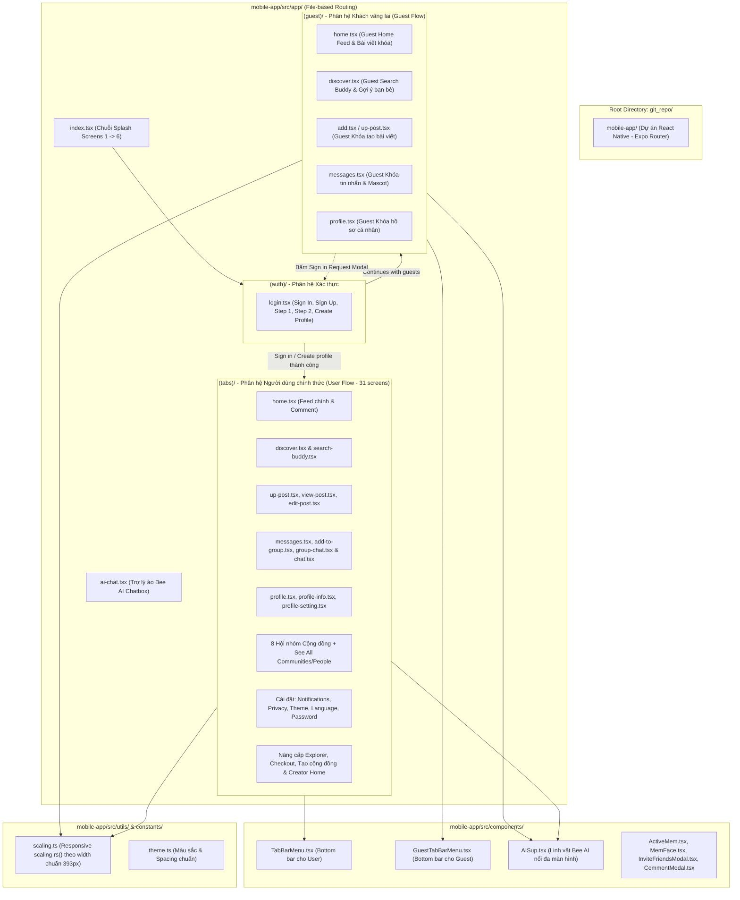

# BeeBuddy Mobile App - Kiến trúc & Source Map

Tài liệu này cung cấp bản đồ mã nguồn (**Source Map**), cấu trúc thư mục, chức năng của toàn bộ các màn hình và thành phần giao diện trong dự án BeeBuddy.

---

## 1. Sơ đồ Kiến trúc Tổng thể (Architecture Diagram)



---

## 2. Chi tiết Cấu trúc Thư mục & Chức năng Giao diện

### A. Phân hệ Định tuyến chính (`mobile-app/src/app/`)
Áp dụng cơ chế **File-based Routing** của Expo Router:

* **[`_layout.tsx`](mobile-app/src/app/_layout.tsx)**: Root Layout khởi tạo ứng dụng, tải bộ font `AfacadFlux` (Regular, Medium, SemiBold, Bold), cấu hình Stack Navigation.
* **[`index.tsx`](mobile-app/src/app/index.tsx)**: Màn hình khởi động tuần tự qua 6 bước Splash (`splash_1.png` ➔ `splash_6.png`), hỗ trợ vuốt chuyển trang, bộ hẹn giờ tự động và nút "Skip" chuyển thẳng vào màn hình xác thực hoặc trang chủ.
* **[`ai-chat.tsx`](mobile-app/src/app/ai-chat.tsx)**: Giao diện hộp thoại tương tác trực tiếp với Trợ lý ảo AI BeeBuddy.
* **[`explore.tsx`](mobile-app/src/app/explore.tsx)**: Màn hình mẫu mặc định của template Expo starter ban đầu.

---

### B. Phân hệ Xác thực (`mobile-app/src/app/(auth)/`)
* **[`login.tsx`](mobile-app/src/app/(auth)/login.tsx)**: Quản lý toàn bộ vòng đời xác thực của ứng dụng qua state điều hướng nội bộ:
  1. `signIn`: Đăng nhập với Email, Mật khẩu, liên kết Quên mật khẩu, nút Chế độ khách (*"Continues with guests"*).
  2. `signUp`: Đăng ký tài khoản ban đầu.
  3. `personalDetails` (**Step 1**): Điền nghề nghiệp, ngày sinh, chọn giới tính kèm thẻ hỗ trợ Bee AI.
  4. `additionalDetails` (**Step 2**): Quốc gia/khu vực, số điện thoại, thẻ tóm tắt thông tin đã hoàn tất.
  5. `createProfile`: Chọn avatar bạn đồng hành (Beezy, Buzzy, Clover, Sunny,...), đặt tên buddy và hoàn tất tạo tài khoản.
  6. `forgotPass`: Nhập email để nhận mã xác minh.
  7. `verifyCode`: Nhập mã OTP 4 số.
  8. `changePass`: Đặt lại mật khẩu mới.

---

### C. Phân hệ Khách vãng lai (`mobile-app/src/app/(guest)/`)
*Phân hệ độc lập 100%, bảo đảm không ảnh hưởng đến luồng code của người dùng đã đăng nhập:*

* **[`_layout.tsx`](mobile-app/src/app/(guest)/_layout.tsx)**: Stack Navigator quản lý các màn hình dành riêng cho khách.
* **[`home.tsx`](mobile-app/src/app/(guest)/home.tsx)**: Bảng tin Guest Home với badge vàng `Public`, thanh tìm kiếm bung mở linh hoạt, 3 bài viết feed với ảnh/bình luận bị khóa bởi lớp phủ tối và modal yêu cầu đăng nhập ([`Sign_In_Request.png`](mobile-app/assets/images/Sign_In_Request.png)).
* **[`discover.tsx`](mobile-app/src/app/(guest)/discover.tsx)**: Khám phá bạn bè cho khách, hiển thị thẻ gợi ý bạn bè ([`FriendSuggestionCard.png`](mobile-app/assets/images/FriendSuggestionCard.png), [`FriendSuggestionCard2.png`](mobile-app/assets/images/FriendSuggestionCard2.png)). Chặn các thao tác kết bạn, nhắn tin, thả tim và hiển thị popup đăng nhập.
* **[`add.tsx`](mobile-app/src/app/(guest)/add.tsx) / [`up-post.tsx`](mobile-app/src/app/(guest)/up-post.tsx)**: Giao diện tạo bài viết ở chế độ khách: Khóa ô nhập caption và tải ảnh, thẻ cảnh báo Guest, nút Login sử dụng màu cam chuyển sắc LinearGradient (`#ffb703` ➔ `#ff7a00`).
* **[`messages.tsx`](mobile-app/src/app/(guest)/messages.tsx)**: Giao diện tin nhắn cho khách: Mascot ảnh động GIF (`guest_messages_mascot.gif`) to rõ sát tiêu đề, banner đăng nhập với ổ khóa LinearGradient cam.
* **[`profile.tsx`](mobile-app/src/app/(guest)/profile.tsx)**: Giao diện hồ sơ cho khách: Mascot được nâng cao lồng vào header wave vàng, 3 thẻ tính năng (Profile, Interests, Connections) kèm icon chuyên biệt (`user234.png`, `heart23.png`, `users234.png`), nút Login LinearGradient cam.

---

### D. Phân hệ Người dùng chính thức (`mobile-app/src/app/(tabs)/`)
*Bao gồm 31 màn hình giao diện:*

1. **Bảng tin & Tương tác**:
   * `home.tsx`: Bảng tin đầy đủ tính năng: đăng bài, thả tim, bình luận với [`CommentModal.tsx`](mobile-app/src/components/CommentModal.tsx).
   * `up-post.tsx`, `view-post.tsx`, `edit-post.tsx`: Quy trình tạo, xem chi tiết và chỉnh sửa bài viết.
2. **Khám phá & Bạn bè**:
   * `discover.tsx`: Trang khám phá sự kiện, hội nhóm.
   * `search-buddy.tsx`: Tìm kiếm bạn bè theo sở thích, ngôn ngữ, địa điểm (kèm thẻ Alpine Trail Buddies).
   * `see-all-communities.tsx`: Danh mục tất cả cộng đồng.
   * `see-all-people.tsx`: Danh mục đề xuất kết nối mọi người.
   * `friend-profile.tsx`: Xem trang cá nhân của bạn bè.
3. **Chi tiết 8 Hội nhóm Cộng đồng**:
   * `book-and-coffee-club.tsx`, `coding-coffee-club.tsx`, `fitness-and-wellness-club.tsx`, `pet-friends-saigon.tsx`, `photography-walk.tsx`, `study-buddy-circle.tsx`, `tech-innovators-hub.tsx`, `weekend-hikers.tsx`.
4. **Hội thoại & Nhắn tin**:
   * `messages.tsx`: Hộp thư đến, danh sách bạn chat, nút tạo nhóm chat `+ Create group chat` và tin nhắn chờ.
   * `add-to-group.tsx`: Giao diện thêm bạn bè vào nhóm chat mới (tìm kiếm, chọn nhiều bạn bè, đặt tên nhóm "Group name" và nút "Create group").
   * `group-chat.tsx`: Giao diện phòng chat nhóm (Group Chat) với cụm avatar thành viên facepile, lịch sử tin nhắn nhiều thành viên, gợi ý trả lời nhanh và ô nhập chat real-time.
   * `chat.tsx`: Khung chat trực tiếp 1-1 với bạn bè.
5. **Hồ sơ cá nhân, Nâng cấp & Cài đặt hệ thống**:
   * `profile.tsx`, `profile-info.tsx`, `profile-setting.tsx`: Quản lý hồ sơ, thẻ thông tin cá nhân và thiết lập tài khoản.
   * `notifications.tsx`, `notification-setting.tsx`: Quản lý thông báo và cấu hình nhận tin.
   * `privacy-safety.tsx`, `change-password.tsx`, `change-password-success.tsx`: Bảo mật và quản lý mật khẩu.
   * `theme.tsx`, `language.tsx`, `about-beebuddy.tsx`, `help-center.tsx`: Tùy biến chủ đề, ngôn ngữ, giới thiệu và trung tâm hỗ trợ.
   * `update-explorer.tsx`, `explorer-checkout.tsx`: Giới thiệu gói Explorer và giao diện thanh toán Apple Pay/Credit Card.
   * `create-community.tsx`: Thiết lập thông tin Nest mới sau thanh toán (ảnh bìa, avatar, tên, chủ đề, vị trí, quyền riêng tư).
   * `alpine-trail-buddies.tsx`: Giao diện Creator Home của cộng đồng vừa tạo (Live banner, cover/avatar, badge You're the creator · Admin, checklist 3 bước kích hoạt Nest, feed empty state và nút viết bài chào mừng).

---

### E. Thư viện Thành phần UI Dùng chung (`mobile-app/src/components/`)
* **[`TabBarMenu.tsx`](mobile-app/src/components/TabBarMenu.tsx)**: Thanh điều hướng đáy dành cho User gồm 5 tab: Trang chủ, Khám phá, Nút thêm (+), Tin nhắn, Hồ sơ cá nhân.
* **[`GuestTabBarMenu.tsx`](mobile-app/src/components/GuestTabBarMenu.tsx)**: Thanh điều hướng đáy dành cho Guest, tích hợp logic điều hướng chuẩn sang các màn hình `/(guest)/*`.
* **[`AISup.tsx`](mobile-app/src/components/AISup.tsx)**: Linh vật chú ong trợ lý AI hiển thị nổi ở góc màn hình, tương tác mở popup nhanh, hỗ trợ cả 2 chế độ User và Guest.
* **[`ActiveMem.tsx`](mobile-app/src/components/ActiveMem.tsx)**: Component hiển thị danh sách thành viên tích cực trong các cộng đồng.
* **[`MemFace.tsx`](mobile-app/src/components/MemFace.tsx)**: Cụm avatar chồng lớp (facepile) cho hội nhóm.
* **[`InviteFriendsModal.tsx`](mobile-app/src/components/InviteFriendsModal.tsx)**: Modal mời bạn bè tham gia cộng đồng.
* **[`CommentModal.tsx`](mobile-app/src/components/CommentModal.tsx)**: Modal bình luận bài đăng.
* **[`CustomSwitch.tsx`](mobile-app/src/components/CustomSwitch.tsx)**: Công tắc toggle vàng cam tùy biến.

---

### F. Thư viện Tiện ích & Hỗ trợ (`mobile-app/src/utils/` & `src/constants/`)
* **[`scaling.ts`](mobile-app/src/utils/scaling.ts)**: Hàm `rs(size)` tính toán co giãn kích thước pixel theo tỷ lệ chuẩn iPhone (chiều rộng 393px), đảm bảo UI hiển thị hoàn hảo trên mọi kích thước màn hình Android và iOS.
* **[`theme.ts`](mobile-app/src/constants/theme.ts)**: Bảng màu và khoảng cách padding/margin tiêu chuẩn.

---

## 3. Hướng dẫn Chạy & Kiểm thử Dự án

1. **Cài đặt thư viện**:
   ```bash
   cd mobile-app
   npm install
   ```
2. **Kiểm tra kiểu dữ liệu (TypeScript Check)**:
   ```bash
   npx tsc --noEmit
   ```
3. **Khởi chạy ứng dụng**:
   ```bash
   npx expo start
   ```
